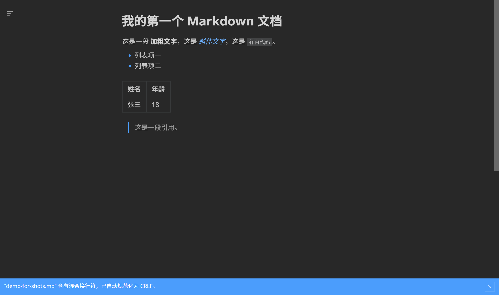
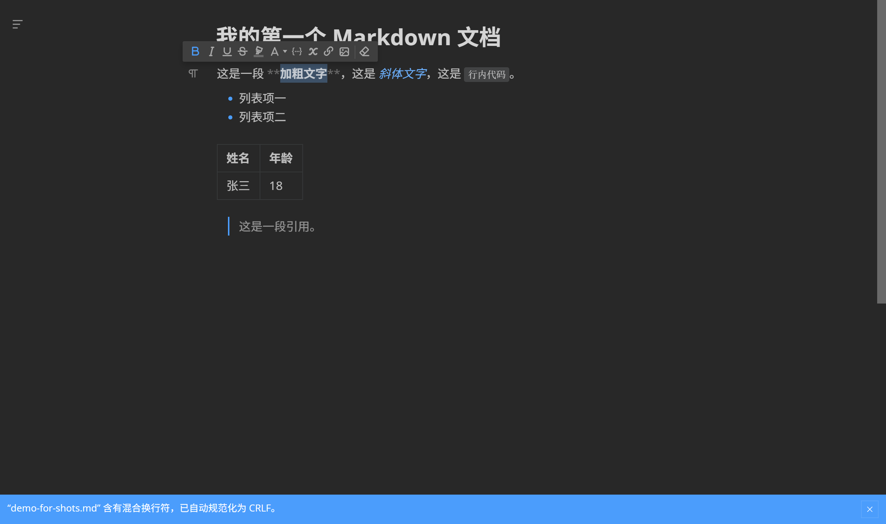
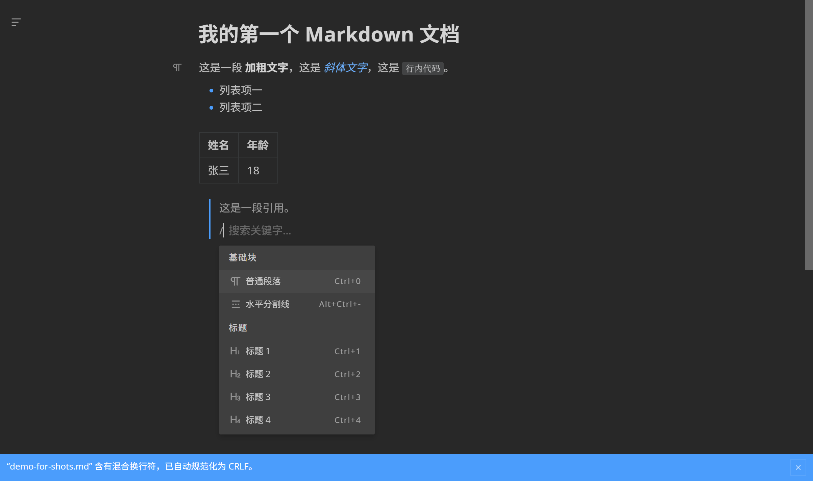
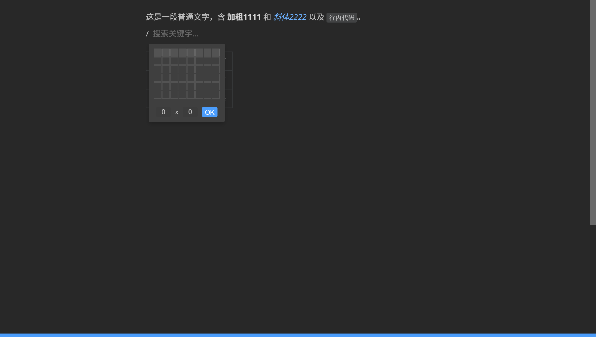

# 新手教学：10 分钟学会 MarkText

> 这份文件本身就是用 MarkText 写的。你现在看到的排版效果，和你敲进去的文字是同一份文件。
> 适合对象：第一次安装 MarkText（0.23.0）的人。照着往下做就行，不用先学 Markdown 语法。

---

## 0. 先理解一件事

普通记事本里你写 `**你好**`，看到的就是 `**你好**`。
MarkText 里你写 `**你好**`，**松开手就变成加粗的「你好」**。

也就是说：你敲的是符号，眼睛看到的是效果。想改「你好」，直接把光标放进去删改，
它仍然是加粗的 —— 不用去管前后那两个星号。

这就是「所见即所得」。

---

## 1. 界面就四个地方

| 位置 | 是什么 |
| --- | --- |
| 最左上角 `≡` | 文件树侧边栏开关（管理文件夹里的 .md） |
| 左上角「字数 xx / xx」 | 选中了几个字 / 全文共几个字 |
| 正上方一行灰字 | 当前文件在电脑里的路径 |
| 空位置 | 正文，**你要写的东西全在这里，直接点进去打字** |

段落左边还会出现一个小图标，鼠标移过去能看到 `+`（插入新块）和拖动手柄（调顺序）。

---

## 2. 三种「加格式」的方式，任选一种

### 方式一：选中文字 → 点浮动工具栏（最像 Word，推荐新手）

**选中**任意文字，会冒出一条小工具栏：

从左到右一共 11 个：加粗、斜体、下划线、删除线、高亮、文字颜色、行内代码、行内数学公式、超链接、图片、清除样式。

想加粗？选中 → 按 `Ctrl + B`，或点浮动工具栏的 `B`。想取消？再按一次 `Ctrl + B`。

**另外两件事：** 图片可以直接**拖进窗口**，或复制后 `Ctrl + V` 粘贴，会自动存到文件旁边；
鼠标移到图片上会出现工具条，可以拖动调整大小。

### 方式二：空行敲一个 `/`（找功能用这个）

在空白段落里敲 `/`，会弹出全部块类型：

光标上下选，回车确认。想插表格、代码块、公式、流程图，都在这里找。

### 方式三：直接敲 Markdown 符号（熟练后最快）

| 你敲 | 变成 |
| --- | --- |
| `**加粗**` | **加粗** |
| `*斜体*` | *斜体* |
| `~~删除线~~` | ~~删除线~~ |
| `` `行内代码` `` | `行内代码` |
| `# 标题` | 一级标题（几个 `#` 就是几级） |
| `- 列表` | 无序列表 |
| `1. 列表` | 有序列表 |
| `> 引用` | 引用块 |
| `---` | 分割线 |

**这里有个新手最容易困惑的点：** 光标正好停在那段加粗文字里时，
前后会露出**淡灰色**的 `**`（上面那张浮动工具栏的截图里就能看到）。
那不是出错，是在提示你「这段的语法是加粗」。光标挪开，它自己就消失了。

---

## 3. 表格：重点讲，因为它最像 Word

### 新建表格

1. 空行敲 `/` → 选「表格」
2. 弹出**行列选择器**：

- 左边**点格子**（最上排最左那个是 1×1）
- 或者直接在 `0 × 0` 里**填数字**：比如填 `4 × 3`，点 **OK**

### 表格里怎么操作

| 想做的事 | 按键 |
| --- | --- |
| **在下面新增一行** | `Enter` ← 已经给你改成这个了 |
| 单元格内换行 | `Shift + Enter` |
| 跳到下一格 | `Tab` |
| 回到上一格 | `Shift + Tab` |
| 上下移动 | `↑` `↓` |
| 插入 / 删除某一行列 | 鼠标移到表格上/左边缘，出现小按钮 |

> 说明：MarkText 原版是 `Enter` 跳到下一行、`Ctrl + Enter` 才插新行。
> 按你的习惯已经改成 `Enter` 直接插新行，`Ctrl + Enter` 仍然可用。

---

## 4. 保存与打开

| 操作 | 怎么做 |
| --- | --- |
| 保存 | `Ctrl + S`（改完记得按，它不是自动保存） |
| 另存为 | `Ctrl + Shift + S` |
| 打开文件 | `Ctrl + O`，或把 .md 文件**拖进窗口** |
| 打开整个文件夹 | `Ctrl + Shift + O`（左侧会出现文件树） |
| 新建标签页 | `Ctrl + T` |

**一个文本文件 = 一个 .md 文件**，可以用任何编辑器打开，不会锁死在这个软件里。

---

## 5. 常见疑问

**Q：为什么有时候会看到 `**`、`#`、`|` 这些符号？**
A：光标停在那个格式范围内时，会临时显示它的语法符号（淡灰色），方便你知道自己在改什么。
移开光标就恢复成排版效果。永远不想看到？按 `Ctrl + E` 切“源码模式”，再按一次切回来。

**Q：我只想看，不想手滑改坏。**
A：`Ctrl + Alt + R` 进入只读模式，或用菜单 `查看 → 阅读模式`。

**Q：菜单里写 Ctrl+1 是标题，按了没反应？**
A：程序里 `Ctrl + 1~9` 被分配给「切换标签页」了，两者冲突。
标题请用 `/` 菜单选，或点菜单栏 `段落`。这是我实测确认过的。

**Q：字体太小 / 想换中文字体？**
A：`Ctrl + ,` 打开偏好设置 → 编辑器 → 字体大小 / 编辑器字体，改完即时生效。

**Q：删错了？**
A：`Ctrl + Z` 撤销，`Ctrl + Shift + Z` 重做。

**Q：关掉时提示有未保存的修改？**
A：因为没按 `Ctrl + S`。想要自动保存：`Ctrl + ,` → 通用 → 自动保存。

---

## 6. 快捷键速查（Windows，程序内置）

**最常用的 8 个**

| 键 | 作用 | 键 | 作用 |
| --- | --- | --- | --- |
| `Ctrl + S` | 保存 | `Ctrl + E` | 源码 / 效果切换 |
| `Ctrl + O` | 打开 | `Ctrl + Z` | 撤销 |
| `Ctrl + B` | 加粗 | `Ctrl + I` | 斜体 |
| `Ctrl + F` | 查找 | `Ctrl + P` | 快速跳转文件 |

**格式**

| 键 | 作用 | 键 | 作用 |
| --- | --- | --- | --- |
| `Ctrl + B` | 加粗 | `Ctrl + I` | 斜体 |
| `Ctrl + U` | 下划线 | `Ctrl + D` | 删除线 |
| `` Ctrl + ` `` | 行内代码 | `Ctrl + L` | 插入链接 |
| `Ctrl + Shift + I` | 插入图片 | `Ctrl + Shift + R` | 清除格式 |

**块与视图**

| 键 | 作用 | 键 | 作用 |
| --- | --- | --- | --- |
| `Ctrl + Shift + T` | 表格 | `Ctrl + Shift + K` | 代码块 |
| `Ctrl + Shift + Q` | 引用 | `Ctrl + G` | 有序列表 |
| `Ctrl + H` | 无序列表 | `Ctrl + Alt + X` | 待办清单 |
| `Ctrl + J` | 侧边栏 | `Ctrl + K` | 目录 |
| `Ctrl + E` | 源码模式 | `Ctrl + Alt + R` | 只读模式 |
| `Ctrl + Shift + P` | 命令面板 | `F11` | 全屏 |

> 记不住没关系：**选中文字看浮动工具栏**，**空行敲 `/`**，这两招覆盖 90% 的场景。

---

## 7. 练习区（就在这个文件里动手）

把光标放到下面每一条的末尾，按回车，然后照着做：

- [ ] 选中这句话，按 `Ctrl + B` 把它加粗
- [ ] 新起一行，敲 `**我学会了**`，看看松手后变成什么样
- [ ] 新起一行，敲 `/`，选「标题 2」
- [ ] 新起一行，敲 `/`，选「表格」，弹出网格后选 3 行 4 列
- [ ] 在表格某个格子里按 `Enter`，看是不是多了一行
- [ ] 选中一段文字，按 `Ctrl + E`，看看源码，再按一次回来

做完这六条，你就已经完全会用这个软件了。

---

## 8. 右键「新建」就能建一个 Markdown 文档

装好之后不必先打开软件：在桌面或任意文件夹里 **右键 → 新建 → Markdown 文档**，
得到的空文件双击就会用 MarkText 打开。

## 9. 导出 / 打印成 PDF

写好要交作业、发群、打印，都走这里：

**文件 → 导出 → PDF**

导出的 PDF 和当前排版一致，可以调：

| 选项 | 建议 |
| --- | --- |
| 纸张 | A4（国内打印通用） |
| 页边距 | 默认即可；要装订就把左边距调大 |
| 页眉页脚 | 交作业建议打开，带上文件名和页码 |
| 书签/大纲 | 长文档打开，方便对方跳转 |

⚠️ 两个常见坑：

1. **中文字体**：导出用系统字体。用微软雅黑 / 宋体没问题；用了自己下载的字体，换台电脑可能变方块。
2. **宽表格**：A4 竖排放不下的表格，改成横向，或拆成两张。

## 10. 插入图片（和 Word 一样用）

四种方式任选：

| 方式 | 怎么做 |
| --- | --- |
| 拖进来 | 把图片文件直接拖到光标处 |
| 粘贴 | 截图后 `Ctrl + V` |
| 菜单 | 插入 → 图片 |
| 打命令 | 输入 `/` → 选「图片」 |

插进去之后：**点一下图片**会出现工具栏，拖动小方块调大小、切换左中右对齐。

⚠️ **最容易丢图的地方**：默认插入的是图片原来的路径，把文档发给别人，图片就没了。
建议改成 **复制到文件夹**：`设置 → 图片` 里把「插入图片后的动作」选成
**复制到文件夹**，并勾选「优先使用相对路径」。这样图片会被复制到指定目录，
文档里写相对路径，整个文件夹一起拷走就行。

## 11. 便携版（不想装、想放 U 盘）

如果拿到的是 `MarkText-0.23.0-便携版.zip`：

1. 解压到任意位置（U 盘、D 盘都行）
2. 双击 `启动 MarkText 便携版.exe`
3. 不安装、不要管理员权限、不写注册表、不建快捷方式

配置和缓存都在同目录 `data\` 里，换电脑整个文件夹拷走即可；想清空设置就删掉 `data\`。

---

版本：MarkText 0.23.0 ｜ Windows 11 ｜ 本教程的配图在同目录 `images/` 里，移动文件时请把文件夹一起移动。
